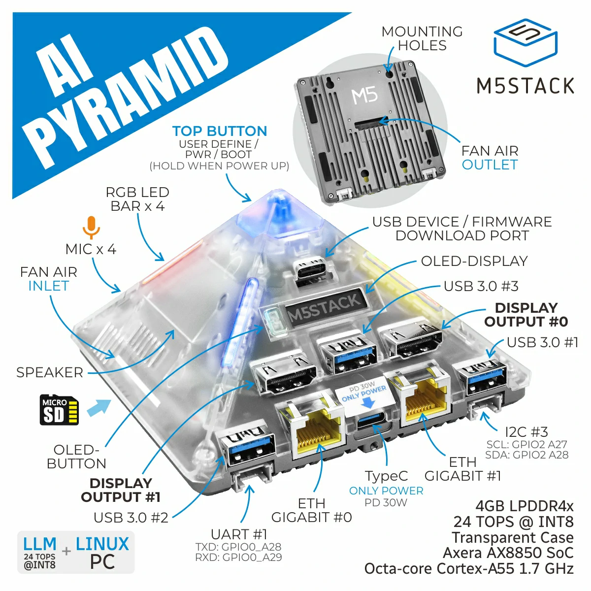
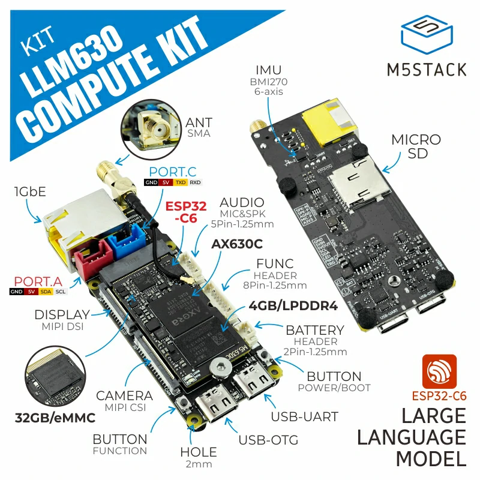
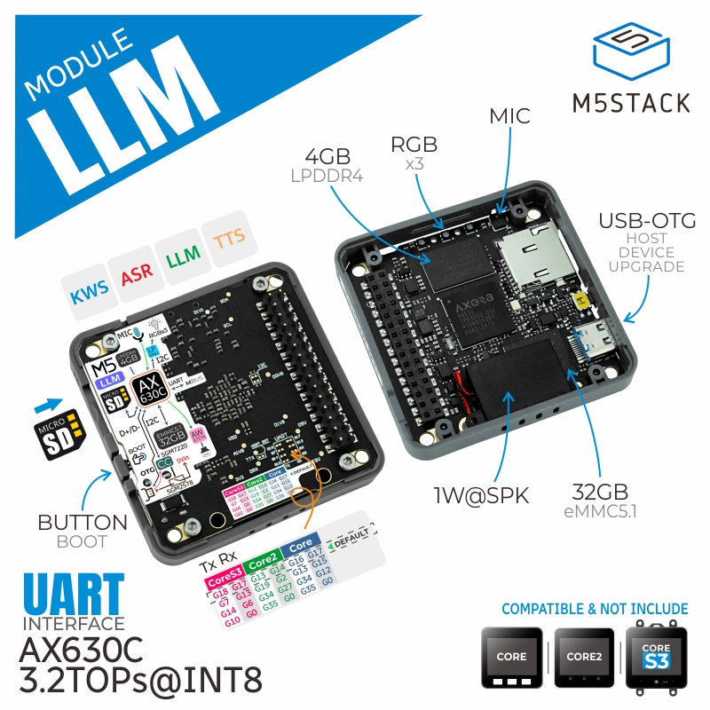

English | [简体中文](./README.md)

# AX-Samples

[](https://raw.githubusercontent.com/AXERA-TECH/ax-samples/main/LICENSE)

| Platform | Build Status |
| -------- | ------------ |
| AX650N   | |
| AX637    | |
| AX630C   | |
| AX620Q   | |
| AX615    | |

## Introduction

**AX-Samples** is developed by **[AXERA](https://www.axera-tech.com/)**. This project provides sample code for common **deep learning open-source algorithms** running on **AXERA AI SoCs**, enabling community developers to quickly evaluate and adapt.

### Supported SoCs

**Edge Computing SoCs**
- [AX650A](https://www.axera-tech.com/zh-hans/product/2929.html) / [AX650N](https://www.axera-tech.com/zh-hans/product/2929.html)
- AX637
- [AX630C](https://www.axera-tech.com/zh-hans/product/2931.html) / [AX620Q](https://www.axera-tech.com/zh-hans/product/2932.html)
- [AX615](https://www.axera-tech.com/zh-hans/product/2956.html)

**Automotive SoCs**
- [M57](https://www.axera-tech.com/zh-hans/product/2826.html)

**Edge AI SoCs**
- [AX8850N](https://www.axera-tech.com/zh-hans/product/2897.html)/[AX8850](https://www.axera-tech.com/zh-hans/product/2896.html)
- AX8860

### Supported Boards

| Board | Image | SoC | Vendor | Link |
| ----- | ----- | --- | ------ | ---- |
| AXera-Pi Pro |  | AX650N | Sipeed | [Wiki](https://wiki.sipeed.com/m4ndock) |
| AI Pyramid |  | AX8850 | M5Stack | [Docs](https://docs.m5stack.com/en/ai_hardware/AI_Pyramid) |
| LLM630 Compute Kit |  | AX630C | M5Stack | [Docs](https://docs.m5stack.com/en/core/LLM630%20Compute%20Kit) |
| Module LLM |  | AX630C | M5Stack | [Docs](https://docs.m5stack.com/en/module/Module-LLM) |

## Directory Structure

```
ax-samples
├── 3rdparty/              # third-party deps; unpack the prebuilt OpenCV here before building
├── benchmark/             # inference time of common models on each SoC
├── cmake/                 # per-SoC build configs (axXXX.cmake) and build checks
├── docs/                  # build guides (compile_*.md), result images, board photos
├── examples/              # sample sources
│   ├── base/              #   shared post-processing: detection, pose, topk, transforms
│   ├── utilities/         #   shared helpers: cmdline parsing, file io, timer
│   ├── ax650/             #   AX650 / AX8850 samples
│   ├── ax637/             #   AX637 samples
│   ├── ax620e/            #   AX630C / AX620Q samples
│   ├── ax615/             #   AX615 samples
│   └── ax8860/            #   AX8860 samples
├── toolchains/            # cross-compile toolchain cmake files
├── CMakeLists.txt         # top-level cmake; pick the SoC with AXERA_TARGET_CHIP
└── AGENTS_EN.md           # quick reference for AI agents: build commands, adding models/SoCs, pitfalls
```

Every SoC directory has the same layout:

```
examples/axXXX/
├── ax_<model>_steps.cc    # one sample per model: preprocess -> NPU inference -> postprocess -> save result
├── middleware/io.hpp      # NPU engine input/output buffer allocation for this SoC
├── CMakeLists.txt         # sample programs built for this SoC
└── README.md              # sample list, run commands and output logs
```

## Quick Start

Three steps:

1. **Build**: follow the [Compilation Guide](docs/compile.md), pick the guide for your SoC and cross-compile the samples with cmake.
2. **Get models**: download axmodels and test images from the resources below, or convert your own with [Pulsar2](https://huggingface.co/AXERA-TECH/Pulsar2).
3. **Run**: copy the binaries, models and images to the board; commands and expected output are in each SoC's README (e.g. [examples/ax650](examples/ax650/README.md)).

### Samples

- [examples](examples/) — Common deep learning open-source algorithms including classification, detection, segmentation, pose estimation, and traditional CV operations. Continuously updated based on community feedback.

### Resources

- **ModelZoo**, **pre-compiled binaries**, **test images** and more:
  - [Huggingface](https://huggingface.co/collections/AXERA-TECH/vision-models-67b0bce92ddc61229e8e94ed)
  - [Modelscope](https://modelscope.cn/organization/AXERA-TECH)

### Benchmark

- [Benchmark](benchmark/) — Inference time statistics for common open-source models, measured on *AXera-Pi Pro*.

## Related Projects

- NPU toolchain online documentation with usage instructions and download links:
  - [Pulsar2 Online Docs](https://pulsar2-docs.readthedocs.io/zh_CN/latest/) (Supports AX650A/AX650N/AX630C/AX620Q)
- Recommended: download the latest Pulsar2 toolchain and documentation directly:
  - [Pulsar2 Download](https://huggingface.co/AXERA-TECH/Pulsar2)

## Technical Discussion

- Github issues
- QQ Group: 139953715
