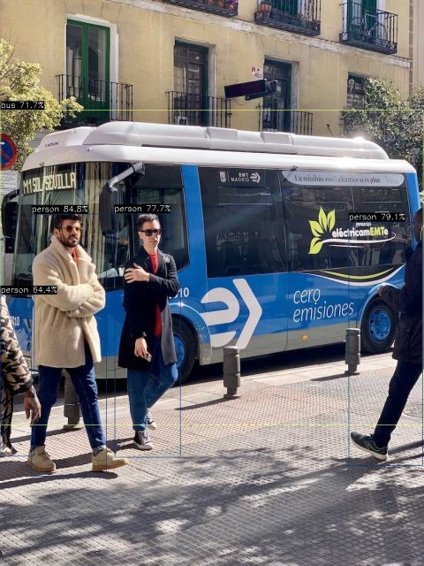
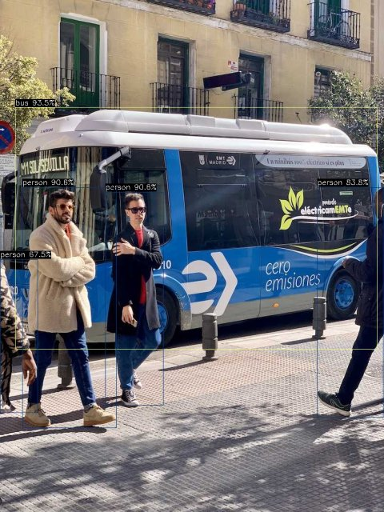
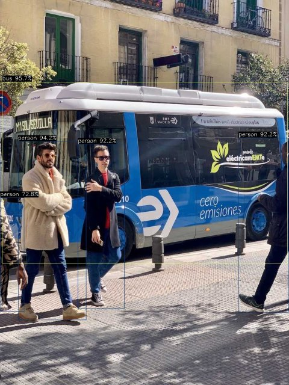
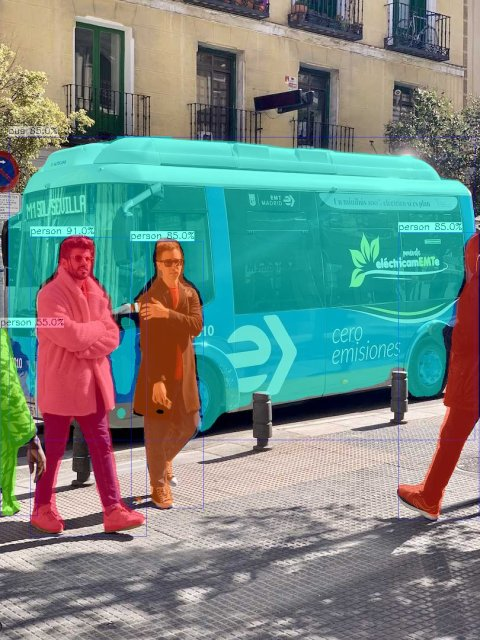
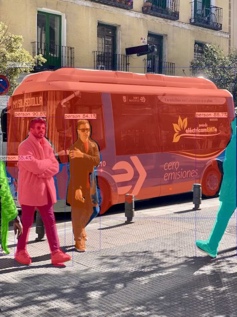
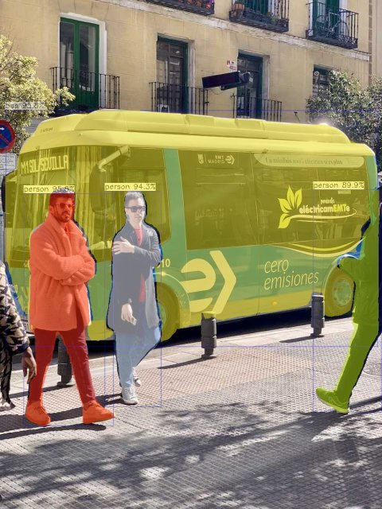
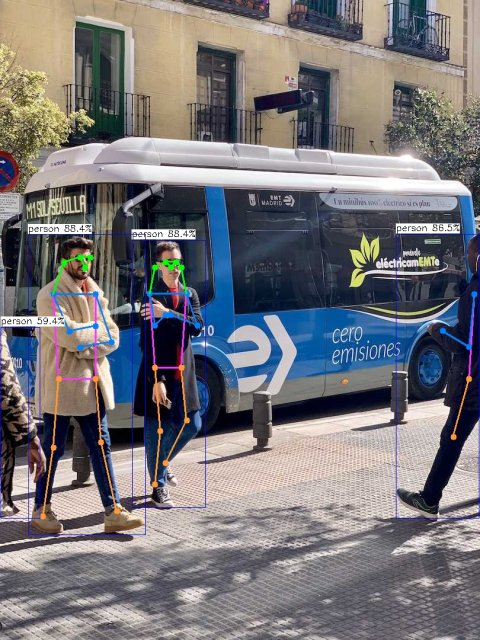
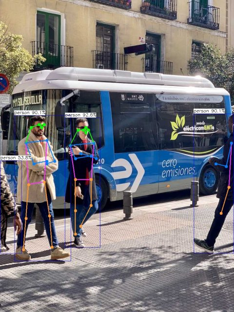
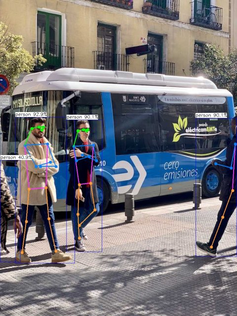

# AX8860 示例

本目录为 AX8860 芯片的 NPU 推理示例，包含图像分类、物体检测、物体分割、人体关键点四类共 11 个示例。编译方法见 [compile_8860.md](../../docs/compile_8860.md)。

## 目录结构

```
examples/ax8860
├── CMakeLists.txt                 # 每个示例一行 axera_example(...)
├── middleware/io.hpp              # NPU 输入输出内存申请/释放（输入必须填 nSize）
├── ax_classification_steps.cc     # 图像分类（MobileNetv2 等 ImageNet 模型）
├── ax_yolov5s_steps.cc            # YOLOv5s 检测
├── ax_yolov8_steps.cc             # YOLOv8 检测
├── ax_yolov8_seg_steps.cc         # YOLOv8 分割
├── ax_yolov8_pose_steps.cc        # YOLOv8 关键点
├── ax_yolo11_steps.cc             # YOLO11 检测
├── ax_yolo11_seg_steps.cc         # YOLO11 分割
├── ax_yolo11_pose_steps.cc        # YOLO11 关键点
├── ax_yolo26_steps.cc             # YOLO26 检测
├── ax_yolo26_seg_steps.cc         # YOLO26 分割
├── ax_yolo26_pose_steps.cc        # YOLO26 关键点
└── README.md
```

示例共用的后处理在 [examples/base](../base)，命令行与计时工具在 [examples/utilities](../utilities)。

## 快速运行

1. 按 [compile_8860.md](../../docs/compile_8860.md) 编译，得到 `build_ax8860/install/ax8860/ax_*`。
2. 将可执行文件、模型与测试图片拷贝到开发板，按如下方式组织：

   ```
   ax-samples/
   ├── ax_classification, ax_yolov8, ...   # install/ax8860/ 下的可执行文件
   ├── models/*.axmodel
   └── images/{cat.jpg,bus.jpg}
   ```

3. 设置动态库路径并运行：

   ```bash
   export LD_LIBRARY_PATH=/opt/lib:$LD_LIBRARY_PATH
   ./ax_yolov8 -m models/yolov8s_npu4.axmodel -i images/bus.jpg -r 10
   ```

参数说明：`-m` 模型（必填），`-i` 图片（必填），`-g` 模型输入尺寸 `h,w`（默认 640,640，分类为 224,224），`-r` 重复推理次数（用于测速）。检测、分割、关键点示例会在当前目录保存结果图 `<模型>_out.jpg`。

## 模型列表

所有模型均为 NPU4 模式，耗时为 NPU 推理 10 次平均值（不含前后处理）。

| 模型 | 任务 | 示例程序 | 模型文件 | 测试图片 | 耗时 (ms) |
| ---- | ---- | ---- | ---- | ---- | ---- |
| [MobileNetv2](#mobilenetv2) | 图像分类 | `ax_classification` | `mobilenetv2_npu4.axmodel` | `cat.jpg` | 0.32 |
| [YOLOv5s](#yolov5s) | 物体检测 | `ax_yolov5s` | `yolov5s_npu4.axmodel` | `bus.jpg` | 0.81 |
| [YOLOv8s](#yolov8s) | 物体检测 | `ax_yolov8` | `yolov8s_npu4.axmodel` | `bus.jpg` | 0.96 |
| [YOLO11s](#yolo11s) | 物体检测 | `ax_yolo11` | `yolo11s_npu4.axmodel` | `bus.jpg` | 0.94 |
| [YOLO26s](#yolo26s) | 物体检测 | `ax_yolo26` | `yolo26s_npu4.axmodel` | `bus.jpg` | 0.98 |
| [YOLOv8s-seg](#yolov8s-seg) | 物体分割 | `ax_yolov8_seg` | `yolov8s-seg_npu4.axmodel` | `bus.jpg` | 1.20 |
| [YOLO11s-seg](#yolo11s-seg) | 物体分割 | `ax_yolo11_seg` | `yolo11s-seg_npu4.axmodel` | `bus.jpg` | 1.23 |
| [YOLO26s-seg](#yolo26s-seg) | 物体分割 | `ax_yolo26_seg` | `yolo26s-seg_npu4.axmodel` | `bus.jpg` | 1.36 |
| [YOLOv8s-pose](#yolov8s-pose) | 人体关键点 | `ax_yolov8_pose` | `yolov8s-pose_npu4.axmodel` | `bus.jpg` | 1.13 |
| [YOLO11s-pose](#yolo11s-pose) | 人体关键点 | `ax_yolo11_pose` | `yolo11s-pose_npu4.axmodel` | `bus.jpg` | 1.15 |
| [YOLO26s-pose](#yolo26s-pose) | 人体关键点 | `ax_yolo26_pose` | `yolo26s-pose_npu4.axmodel` | `bus.jpg` | 1.17 |

## 模型转换

模型使用 Pulsar2 7.0 转换，目标平台为 AX8860：

```bash
pulsar2 build --config config.json --target_hardware AX8860 --npu_mode NPU4
```

YOLOv8 系列的 onnx 若为每个 stride 拆分输出（box 64 + cls 80 / 1），需先在 onnx 中将同一 stride 的 box 与 cls 在通道维 Concat，得到与 `ax_yolov8*` 后处理一致的输出：

- YOLOv8s：3 x (1 x H x W x 144)
- YOLOv8s-seg：3 x (1 x H x W x 144)，3 x (1 x H x W x 32)，1 x 32 x 160 x 160
- YOLOv8s-pose：3 x (1 x H x W x 65)，3 x (1 x H x W x 51)

## 运行示例

检测、分割、关键点示例统一使用 [bus.jpg](https://ultralytics.com/images/bus.jpg) 测试，点击「完整输出」查看日志。

### MobileNetv2

```bash
./ax_classification -m models/mobilenetv2_npu4.axmodel -i images/cat.jpg -r 10
```

top5（分数, ImageNet 类别 id）：

```
10.1433, 285
9.4579, 282
9.3208, 281
8.9096, 283
8.2243, 287
```

<details>
<summary>完整输出</summary>

```
# ./ax_classification -m models/mobilenetv2_npu4.axmodel -i images/cat.jpg -r 10
--------------------------------------
model file : models/mobilenetv2_npu4.axmodel
image file : images/cat.jpg
img_h, img_w : 224 224
--------------------------------------
Engine creating handle is done.
Engine creating context is done.
Engine get io info is done.
Engine alloc io is done.
Engine push input is done.
--------------------------------------
topk cost time:0.07 ms
10.1433, 285
9.4579, 282
9.3208, 281
8.9096, 283
8.2243, 287
--------------------------------------
Repeat 10 times, avg time 0.32 ms, max_time 0.33 ms, min_time 0.32 ms
--------------------------------------
```

</details>

### YOLOv5s

```bash
./ax_yolov5s -m models/yolov5s_npu4.axmodel -i images/bus.jpg -r 10
```


<details>
<summary>完整输出</summary>

```
# ./ax_yolov5s -m models/yolov5s_npu4.axmodel -i images/bus.jpg -r 10
--------------------------------------
model file : models/yolov5s_npu4.axmodel
image file : images/bus.jpg
img_h, img_w : 640 640
--------------------------------------
Engine creating handle is done.
Engine creating context is done.
Engine get io info is done.
Engine alloc io is done.
Engine push input is done.
--------------------------------------
post process cost time:4.89 ms
--------------------------------------
Repeat 10 times, avg time 0.81 ms, max_time 0.82 ms, min_time 0.80 ms
--------------------------------------
detection num: 5
 0:  85%, [  60,  408,  204,  909], person
 0:  79%, [ 666,  424,  808,  889], person
 0:  78%, [ 219,  408,  345,  872], person
 5:  72%, [   1,  210,  809,  811], bus
 0:  64%, [   1,  563,   66,  871], person
--------------------------------------
```

</details>

### YOLOv8s

```bash
./ax_yolov8 -m models/yolov8s_npu4.axmodel -i images/bus.jpg -r 10
```


<details>
<summary>完整输出</summary>

```
# ./ax_yolov8 -m models/yolov8s_npu4.axmodel -i images/bus.jpg -r 10
--------------------------------------
model file : models/yolov8s_npu4.axmodel
image file : images/bus.jpg
img_h, img_w : 640 640
--------------------------------------
Engine creating handle is done.
Engine creating context is done.
Engine get io info is done.
Engine alloc io is done.
Engine push input is done.
--------------------------------------
post process cost time:4.14 ms
--------------------------------------
Repeat 10 times, avg time 0.96 ms, max_time 0.98 ms, min_time 0.94 ms
--------------------------------------
detection num: 5
 5:  89%, [  20,  229,  801,  740], bus
 0:  89%, [  48,  398,  243,  905], person
 0:  86%, [ 668,  394,  809,  874], person
 0:  83%, [ 223,  405,  348,  860], person
 0:  56%, [   0,  555,   65,  869], person
--------------------------------------
```

</details>

### YOLO11s

```bash
./ax_yolo11 -m models/yolo11s_npu4.axmodel -i images/bus.jpg -r 10
```


<details>
<summary>完整输出</summary>

```
# ./ax_yolo11 -m models/yolo11s_npu4.axmodel -i images/bus.jpg -r 10
--------------------------------------
model file : models/yolo11s_npu4.axmodel
image file : images/bus.jpg
img_h, img_w : 640 640
--------------------------------------
Engine creating handle is done.
Engine creating context is done.
Engine get io info is done.
Engine alloc io is done.
Engine push input is done.
--------------------------------------
post process cost time:3.92 ms
--------------------------------------
Repeat 10 times, avg time 0.94 ms, max_time 0.96 ms, min_time 0.93 ms
--------------------------------------
detection num: 5
 5:  94%, [  32,  226,  796,  738], bus
 0:  91%, [ 222,  405,  346,  855], person
 0:  91%, [  47,  395,  246,  903], person
 0:  84%, [ 669,  395,  809,  881], person
 0:  67%, [   0,  547,   80,  871], person
--------------------------------------
```

</details>

### YOLO26s

```bash
./ax_yolo26 -m models/yolo26s_npu4.axmodel -i images/bus.jpg -r 10
```


<details>
<summary>完整输出</summary>

```
# ./ax_yolo26 -m models/yolo26s_npu4.axmodel -i images/bus.jpg -r 10
--------------------------------------
model file : models/yolo26s_npu4.axmodel
image file : images/bus.jpg
img_h, img_w : 640 640
--------------------------------------
Engine creating handle is done.
Engine creating context is done.
Engine get io info is done.
Engine alloc io is done.
Engine push input is done.
--------------------------------------
post process cost time:2.94 ms
--------------------------------------
Repeat 10 times, avg time 0.98 ms, max_time 1.00 ms, min_time 0.98 ms
--------------------------------------
detection num: 5
 5:  96%, [   6,  230,  806,  739], bus
 0:  94%, [  51,  396,  242,  898], person
 0:  92%, [ 668,  387,  809,  876], person
 0:  92%, [ 218,  404,  350,  866], person
 0:  73%, [   1,  554,   67,  874], person
--------------------------------------
```

</details>

### YOLOv8s-seg

```bash
./ax_yolov8_seg -m models/yolov8s-seg_npu4.axmodel -i images/bus.jpg -r 10
```


<details>
<summary>完整输出</summary>

```
# ./ax_yolov8_seg -m models/yolov8s-seg_npu4.axmodel -i images/bus.jpg -r 10
--------------------------------------
model file : models/yolov8s-seg_npu4.axmodel
image file : images/bus.jpg
img_h, img_w : 640 640
--------------------------------------
Engine creating handle is done.
Engine creating context is done.
Engine get io info is done.
Engine alloc io is done.
Engine push input is done.
--------------------------------------

input size: 1
    name:   images [UINT8] [unknown]
        1 x 640 x 640 x 3


output size: 7
    name:  stride8 [FLOAT32]
        1 x 80 x 80 x 144

    name: stride16 [FLOAT32]
        1 x 40 x 40 x 144

    name: stride32 [FLOAT32]
        1 x 20 x 20 x 144

    name:      402 [FLOAT32]
        1 x 80 x 80 x 32

    name:      468 [FLOAT32]
        1 x 40 x 40 x 32

    name:      534 [FLOAT32]
        1 x 20 x 20 x 32

    name:      564 [FLOAT32]
        1 x 32 x 160 x 160

post process cost time:14.76 ms
--------------------------------------
Repeat 10 times, avg time 1.20 ms, max_time 1.22 ms, min_time 1.20 ms
--------------------------------------
detection num: 5
 0:  91%, [  51,  400,  248,  906], person
 5:  85%, [  15,  231,  801,  743], bus
 0:  85%, [ 221,  407,  344,  859], person
 0:  85%, [ 672,  392,  809,  878], person
 0:  55%, [   0,  553,   64,  871], person
--------------------------------------
```

</details>

### YOLO11s-seg

```bash
./ax_yolo11_seg -m models/yolo11s-seg_npu4.axmodel -i images/bus.jpg -r 10
```


<details>
<summary>完整输出</summary>

```
# ./ax_yolo11_seg -m models/yolo11s-seg_npu4.axmodel -i images/bus.jpg -r 10
--------------------------------------
model file : models/yolo11s-seg_npu4.axmodel
image file : images/bus.jpg
img_h, img_w : 640 640
--------------------------------------
Engine creating handle is done.
Engine creating context is done.
Engine get io info is done.
Engine alloc io is done.
Engine push input is done.
--------------------------------------

input size: 1
    name:   images [UINT8] [unknown]
        1 x 640 x 640 x 3


output size: 7
    name: /model.23/Concat_1_output_0 [FLOAT32]
        1 x 80 x 80 x 144

    name: /model.23/Concat_2_output_0 [FLOAT32]
        1 x 40 x 40 x 144

    name: /model.23/Concat_3_output_0 [FLOAT32]
        1 x 20 x 20 x 144

    name: /model.23/cv4.0/cv4.0.2/Conv_output_0 [FLOAT32]
        1 x 80 x 80 x 32

    name: /model.23/cv4.1/cv4.1.2/Conv_output_0 [FLOAT32]
        1 x 40 x 40 x 32

    name: /model.23/cv4.2/cv4.2.2/Conv_output_0 [FLOAT32]
        1 x 20 x 20 x 32

    name:  output1 [FLOAT32]
        1 x 32 x 160 x 160

post process cost time:15.75 ms
--------------------------------------
Repeat 10 times, avg time 1.23 ms, max_time 1.27 ms, min_time 1.22 ms
--------------------------------------
detection num: 5
 0:  91%, [  50,  398,  249,  907], person
 0:  87%, [ 669,  400,  809,  879], person
 0:  84%, [ 222,  405,  343,  858], person
 5:  78%, [  24,  229,  802,  743], bus
 0:  55%, [   0,  548,   63,  870], person
--------------------------------------
```

</details>

### YOLO26s-seg

```bash
./ax_yolo26_seg -m models/yolo26s-seg_npu4.axmodel -i images/bus.jpg -r 10
```


<details>
<summary>完整输出</summary>

```
# ./ax_yolo26_seg -m models/yolo26s-seg_npu4.axmodel -i images/bus.jpg -r 10
--------------------------------------
model file : models/yolo26s-seg_npu4.axmodel
image file : images/bus.jpg
img_h, img_w : 640 640
--------------------------------------
Engine creating handle is done.
Engine creating context is done.
Engine get io info is done.
Engine alloc io is done.
Engine push input is done.
--------------------------------------
post process cost time:14.10 ms
--------------------------------------
Repeat 10 times, avg time 1.36 ms, max_time 1.40 ms, min_time 1.35 ms
--------------------------------------
detection num: 4
 0:  96%, [  50,  410,  242,  904], person
 5:  96%, [  12,  234,  801,  736], bus
 0:  94%, [ 222,  406,  342,  864], person
 0:  90%, [ 664,  402,  809,  876], person
--------------------------------------
```

</details>

### YOLOv8s-pose

```bash
./ax_yolov8_pose -m models/yolov8s-pose_npu4.axmodel -i images/bus.jpg -r 10
```


<details>
<summary>完整输出</summary>

```
# ./ax_yolov8_pose -m models/yolov8s-pose_npu4.axmodel -i images/bus.jpg -r 10
--------------------------------------
model file : models/yolov8s-pose_npu4.axmodel
image file : images/bus.jpg
img_h, img_w : 640 640
--------------------------------------
Engine creating handle is done.
Engine creating context is done.
Engine get io info is done.
Engine alloc io is done.
Engine push input is done.
--------------------------------------
post process cost time:1.54 ms
--------------------------------------
Repeat 10 times, avg time 1.13 ms, max_time 1.16 ms, min_time 1.12 ms
--------------------------------------
detection num: 4
 0:  88%, [ 223,  405,  347,  857], person
 0:  88%, [  48,  395,  246,  903], person
 0:  87%, [ 668,  395,  809,  875], person
 0:  59%, [   1,  552,   68,  875], person
--------------------------------------
```

</details>

### YOLO11s-pose

```bash
./ax_yolo11_pose -m models/yolo11s-pose_npu4.axmodel -i images/bus.jpg -r 10
```


<details>
<summary>完整输出</summary>

```
# ./ax_yolo11_pose -m models/yolo11s-pose_npu4.axmodel -i images/bus.jpg -r 10
--------------------------------------
model file : models/yolo11s-pose_npu4.axmodel
image file : images/bus.jpg
img_h, img_w : 640 640
--------------------------------------
Engine creating handle is done.
Engine creating context is done.
Engine get io info is done.
Engine alloc io is done.
Engine push input is done.
--------------------------------------
post process cost time:1.54 ms
--------------------------------------
Repeat 10 times, avg time 1.15 ms, max_time 1.17 ms, min_time 1.13 ms
--------------------------------------
detection num: 4
 0:  93%, [ 225,  407,  347,  858], person
 0:  90%, [  50,  399,  245,  904], person
 0:  90%, [ 671,  394,  809,  878], person
 0:  54%, [   1,  556,   75,  877], person
--------------------------------------
```

</details>

### YOLO26s-pose

```bash
./ax_yolo26_pose -m models/yolo26s-pose_npu4.axmodel -i images/bus.jpg -r 10
```


<details>
<summary>完整输出</summary>

```
# ./ax_yolo26_pose -m models/yolo26s-pose_npu4.axmodel -i images/bus.jpg -r 10
--------------------------------------
model file : models/yolo26s-pose_npu4.axmodel
image file : images/bus.jpg
img_h, img_w : 640 640
--------------------------------------
Engine creating handle is done.
Engine creating context is done.
Engine get io info is done.
Engine alloc io is done.
Engine push input is done.
--------------------------------------
post process cost time:0.22 ms
--------------------------------------
Repeat 10 times, avg time 1.17 ms, max_time 1.18 ms, min_time 1.16 ms
--------------------------------------
detection num: 4
 0:  93%, [  53,  401,  256,  899], person
 0:  90%, [ 669,  404,  809,  878], person
 0:  90%, [ 227,  409,  349,  861], person
 0:  41%, [   1,  547,   70,  896], person
--------------------------------------
```

</details>
